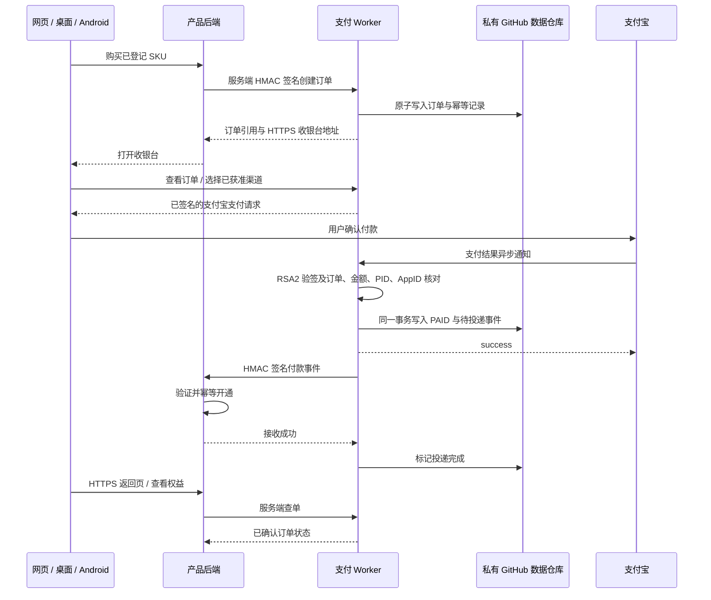

# 统一支付服务架构

本项目在 Cloudflare Worker 上提供 Brclio 自营产品的统一支付入口，计划公开域名为 `https://pay.bornforthis.cn`。Worker 启用 `nodejs_compat`；所有持久数据写入专用私有 GitHub 仓库。不使用 D1、KV 或 Durable Objects。

## 付款与产品开通



产品必须有可信后端，才能持有创建订单和查询订单所需的 API Secret。浏览器、桌面安装包和 Android 安装包都不能安全保存长期商户 Secret；客户端应先调用自己的产品后端。

## 产品隔离与固定价格

管理后台的加密注册表登记产品 ID、显示名、独立 API Secret、独立 webhook Secret、HTTPS webhook、允许的回跳 origin，以及 SKU 的标题、金额和可选商品说明、权益说明、停售状态。配置结构见 `src/types.ts` 中的 `ProductClient`。`CLIENTS_JSON` 仅在加密记录不存在时提供初始化基线，不能覆盖已保存的注册表。

创建订单使用产品订单号及 SKU。支付中心从服务端配置取得价格，以十进制金额字符串保存，金额核对使用整数分语义，避免浮点比较。产品输入不能覆盖金额、支付宝收款账号、通知地址或其他产品配置。

创建订单应保证 `(clientId, productOrderId)` 唯一，保存请求摘要；相同订单和相同内容重复请求返回同一订单，内容不同则拒绝，防止同一业务订单被改价或复用到不同商品。

付款期限为 `createdAt + 10 分钟`，同样适用于已有待付款订单。到期即禁止发起付款；幂等重放不会重置期限，关闭后重新购买需新建产品业务订单号，不能覆盖旧单。

订单只能由所属产品查询。回跳仅允许该产品配置中的 HTTPS origin；`brclio.com` 和每个实际子域名分别登记。配置不能被来访请求中的任意 URL 覆盖。首版不支持任意第三方商户使用同一收款账号代收、分账或结算。

## 请求与通知的信任边界

产品后端使用以下请求头，对请求方法、路径、时间戳、唯一请求标识和原始请求体进行 HMAC-SHA256 签名：

| 请求头 | 内容 |
| --- | --- |
| `X-Brclio-Client` | 登记的产品 ID |
| `X-Brclio-Timestamp` | Unix 秒时间戳，允许 5 分钟时间偏差 |
| `X-Brclio-Nonce` | 唯一请求标识，匹配 `[A-Za-z0-9_-]{16,80}` |
| `X-Brclio-Signature` | 使用产品 `apiSecret` 生成的十六进制 HMAC-SHA256 |

签名原文为以下五项按换行连接，末尾不额外加换行：

```text
METHOD_UPPERCASE
pathname
timestamp
nonce
sha256_hex(rawBody)
```

这些服务端 API 不接受 query string。GET 使用空请求体的 SHA-256 摘要；POST 必须对最终发送的原始 JSON 字节计算摘要，不能签名后再重新序列化成不同文本。服务端验证签名和时间窗口，并限制幂等冲突及跨产品访问；创建订单通过不可变的产品订单号和请求摘要抵御重复创建，查询请求的重复读取没有开通副作用。HTTPS 页面令牌由单独的 `CHECKOUT_SECRET` 签名，不复用产品 API Secret。

| 路由 | 用途 |
| --- | --- |
| `POST /api/v1/orders` | 产品后端创建订单 |
| `GET /api/v1/orders/:id` | 产品后端读取订单状态 |
| `POST /api/v1/orders/:id/refresh` | 产品后端请求补偿查单（未到期时节流）或到期关单 |
| `GET /checkout/:id` | 用户收银台页面 |
| `GET /api/checkout/:id` | 使用收银台令牌读取结果 |
| `POST /api/checkout/:id/pay` | 使用收银台令牌发起允许的支付渠道 |
| `POST /api/checkout/:id/refresh` | 使用收银台令牌请求补偿查单（未到期时节流）或到期关单 |
| `POST /api/alipay/notify` | 支付宝异步通知 |
| `GET /payment/return` | 按 `out_trade_no` 返回收银台，查询真实状态 |

支付宝使用独立的 RSA2 信任链。异步通知必须先通过支付宝公钥验签，再核对以下业务字段：

- `out_trade_no` 为支付中心已创建的订单。
- `total_amount` 与不可变订单金额一致。
- `seller_id` 与配置的实际收款 PID 一致。
- `app_id` 与当前环境的 AppID 一致；正式应用为 `2021007109602288`。
- `trade_status` 仅在 `TRADE_SUCCESS` 或 `TRADE_FINISHED` 时作为已付款处理。

通知表单只解码一次，签名校验不得忽略未知的业务字段或自行二次解码。重复字段和格式异常应拒绝。校验失败不改变订单；处理成功后返回纯文本 `success`。重复成功通知不重复创建开通事件，迟到的待支付状态不能把已支付订单回退。

支付宝前台回跳只显示结果和引导返回产品。客户端同步结果、URL 参数、截图和 CORS origin 都不能构成资金到账凭证。支付宝官方要求业务校验与过滤重复通知，最终结果以异步通知或主动查询为准。[通知规范](https://developer.alibaba.com/docs/doc.htm?articleId=105902&docType=1&source=search&treeId=193)、[PC 接入流程](https://developer.alibaba.com/docs/doc.htm?articleId=105899&docType=1&treeId=270)

## 渠道能力边界

首版可生成电脑网站支付 `alipay.trade.page.pay` 和手机网站支付 `alipay.trade.wap.pay` 的支付请求。`ALIPAY_CHANNELS` 是部署端能力白名单，默认 `page`；只有控制台确认对应签约后才加入 `wap`。AppID 创建成功不等于渠道权限生效。

桌面和 Android 客户端打开系统浏览器收银台，使用允许的 HTTPS 页面接收回跳。首版没有集成原生 App 支付 SDK、原生应用深链回跳或 `alipay.trade.precreate` 当面付。PC 收银台的扫码功能由电脑网站支付产品提供，不表示开通了当面付。

官方说明手机网站支付用于浏览器支付，App 内嵌 WebView 场景建议接入 App 支付；不要把 WebView 唤起异常当作付款失败，也不要把 SDK 订单字符串生成成功当作实际扣款。[手机网站支付接入](https://developer.alibaba.com/docs/doc.htm?articleId=105285&docType=1&source=search&treeId=346)、[App 支付服务端示例](https://developer.alibaba.com/docs/doc.htm?articleId=106370&docType=1&treeId=193)、[官方 SDK](https://github.com/alipay/alipay-sdk-nodejs-all)

统一收银台的跨域技术可行性不能替代支付宝对实际经营、域名及签约的审核。备案 `bornforthis.cn` 不自动意味着 `brclio.com` 的全部业务获准收款，新增产品仍应登记真实商品和业务信息。

## GitHub 事务与原子 outbox

持久层读取目标分支当前提交，在该快照上读取事务所需 JSON，生成所有变更对应的 Git blob、tree 和 commit，最后以非强制方式更新分支引用。其他 Worker 已先更新分支时，本次更新应失败，重新读取快照后有限次重试业务事务，不能强制覆盖并发提交。

订单变为 `PAID`、付款事件写入 outbox、待处理工作队列及报表索引更新，在同一次 Git 提交中完成。因此不会出现“已落库付款、但待发送开通事件完全丢失”的部分写入。创建订单、确认关闭和通知送达也在对应订单事务内更新报表。事务回调只计算和写入持久状态，不在会重试的回调内发起扣款或产品 webhook 等外部副作用。

提交成功后，投递器取出待发送事件，通过该产品的独立 webhook Secret 对事件签名。请求头为 `X-Brclio-Event`、`X-Brclio-Timestamp`、`X-Brclio-Signature`；签名使用 `HMAC-SHA256(webhookSecret, timestamp + '.' + rawBody)` 的十六进制结果。产品先校验时间窗口，再对收到的原始请求体计算并比较签名。

事件包含稳定的 `id`、`type: 'payment.paid'`、`createdAt`，以及 `data` 中的 `orderId`、`productOrderId`、`clientId`、`sku`、`amount`、`currency: 'CNY'`、`tradeNo` 和 `paidAt`。产品核对签名、事件 ID、业务订单、SKU、金额与付款状态，成功开通后返回接收确认。发送后标记完成；中间失败会重试，所以这是**至少一次投递**，产品必须幂等开通。

并发投递通过持久化、带过期时间的领取标识限制。领取、发送、完成三步存在崩溃窗口，允许事件再次投递；产品验签和事件去重仍是必要条件。投递成功只证明产品接收端按约定确认，实际权益是否已开通还需产品后端保证。

## 查单、轮询和计划任务

Cron 默认每 5 分钟处理持久化工作队列：补偿查询仍待支付订单，收尾超过 10 分钟的未付款订单，并重试到期的 webhook。主动刷新也执行同一到期收尾。到期立即禁止发起付款；在没有队列积压且上游正常时，后台通常在下一轮将其关闭，即创建后约 10–15 分钟。未知错误保留待处理状态，不把超时或接口异常解释为付款成功或已确认关闭。

五个公开 CSS/JS 文件继续使用静态分发，具体名单见 deployment.md。付款接口、返回 HTML、查单与通知仍经过原 Worker，安全头与 no-store 策略保留。Cron 频率、轮询频率及通知重试能力保留；配置检查、取批次与队列轮转顺序也保持原样。空队列预探测会给活跃路径增加请求，提前轮转则可能延迟配置故障后的补偿，因此未采用这两项后台优化。

主动调用 `alipay.trade.query` 后必须验证支付宝返回签名，并核对订单、金额和成功交易状态，再走同一套原子付款确认逻辑。状态变化不因来源不同而绕过 outbox。[官方查询接口](https://developer.alibaba.com/docs/doc.htm?articleId=757&docType=4&treeId=180)

页面普通轮询只读取已持久化的状态，不应每次写入 GitHub。未到期订单主动刷新支付宝状态时，先通过 `lastCheckedAt` 持久化节流至同一订单最多每 60 秒一次，间隔内复用已有结果。到期订单直接执行关单收尾，不再预写 `lastCheckedAt`；查询或关单失败保留原单与队列，不产生仅更新时间戳的提交。队列处理限制单次批量，持续失败保留可重试的待处理记录。

订单到期后先验签查询支付宝并核对订单和金额：已付仍走原子付款确认；查询确认交易不存在或已关闭时确认本地 `CLOSED`；已有未付款交易则调用支付宝关单，取得成功确认后才能关闭。查询或关单失败时仍为 `PENDING`、保留队列重试，付款入口继续关闭。订单 `CLOSED`、移出待查队列及报表更新在同一事务提交，后续定时任务不再为它更新时间戳。关单不能覆盖并发确认的 `PAID`；迟到的有效付款通知仍可将 `CLOSED` 恢复为 `PAID` 并生成幂等 outbox，产品继续按历史快照履约。

历史已签发的 30 分钟支付宝链接不能追溯修改其 `time_expire`；本地到期拒绝重新发起并不撤销旧链接。需要通过上游关单完成收尾，迟到的真实付款仍照常核对入账，不能因新期限而丢弃。

## 管理营业额与订单记录

管理员登录后读取以下接口；补建属于写操作，必须同时满足同源 Origin 和 CSRF 验证。接口不返回商户密钥、产品凭证、请求摘要或订单返回 URL。

| 接口 | 参数与用途 |
| --- | --- |
| `GET /api/admin/reports/summary` | `month=YYYY-MM`，可选 `clientId`；返回当月统计、逐日趋势、全历史已确认金额与笔数、索引覆盖状态 |
| `GET /api/admin/reports/orders` | 可选 `month`、`clientId`、`status=PENDING/PAID/CLOSED`、`limit`、`cursor`；按创建时间倒序读取记录 |
| `POST /api/admin/reports/rebuild` | JSON `{limit?,cursor?}`；小批量补建旧订单的报表索引，响应给出进度和下一游标 |

金额字段 `paidAmountCents` 采用整数分，币种固定为 CNY；支付确认后使用订单创建时保存的金额，改价不重算历史订单。这里的“营业额”是 **支付中心已确认的付款金额**，不是支付宝净结算额，也不是扣手续费或退款后的净收入。`live` 与 `sandbox` 按环境分开统计，不能将沙箱金额计入正式营业额。

所有月份、日期和日趋势使用 `Asia/Shanghai`。`paidCount`、成交金额、`deliveryPendingCount` 按 `paidAt` 所在月份计算；`paidAt` 优先为已验签支付宝通知 `gmt_payment` 或查单 `send_pay_date` 的实际付款时间，按上海时区解析后保存为 UTC ISO。未提供时间的旧数据回退为首次中心确认时间；提供但格式无效时拒绝确认，已有 PAID 快照不因重复通知或查单改写。付款时间不能替代支付宝结算日期。`pendingCount` 与 `closedCount` 是指定月份创建订单的当前账本状态。过期但尚未获得关闭确认的订单仍为 `PENDING`。订单列表的 `month` 筛选创建月份，因此与同月付款明细的范围可能不同。通知待送达表示付款事件尚未被接收端成功确认，不证明产品实际权益是否已经落库。

报表使用 GitHub 当前提交的不可变 tree/blob 快照，目录与统计读取来自同一版本。持久文件按用途分开：

- `reporting/v1/orders/{mode}/{创建月}/{时间}_{订单ID}.json`：单笔订单投影，只包含管理展示所需的字段。
- `reporting/v1/{mode}/summary/all/months/{月}.json` 与 `summary/clients/{clientId}/months/{月}.json`：全平台/单平台月计数，日趋势最多 31 项。
- 对应 `summary/all/total.json` 与 `summary/clients/{clientId}/total.json`：固定字段的全历史已确认金额、笔数，不是追加订单的无限增长数组。

单笔索引是幂等更新的依据：重复付款通知不会重复累计，关闭后迟到的真实付款会移除关闭计数并累计付款，投递成功只减少通知待送达。索引与源订单、outbox 共同提交，事务冲突重试不会多算。

已有旧订单可能尚无索引。每次响应的 `coverage` 将整个账本中的源订单路径与索引路径比较，包含 `scope: ledger`、`sourceOrders`、`indexedOrders`、`missingOrders`、`complete` 与检查时间；即使按单个平台查看，覆盖检查仍针对同仓整个账本。`complete=false` 时，金额和列表只反映已索引部分，不能宣称历史完整。补建仅读取源订单并维护报表，不调用支付宝、不生成付款事件、不改订单或产品权益。可重复调用并使用响应的 `nextCursor` 续接，直到覆盖完整；同一订单不会重复累计。

每页最多 25 笔，单次最多扫描 40 个索引 blob。筛选较窄时可能返回短页或空页，但仍有 `nextCursor`，调用方必须继续翻页。游标只包含筛选指纹与索引位置，不含授权或产品凭证。每次补建最多 5 笔，默认 5 笔，用于限制 GitHub/Worker 请求开销。

## 容量与运维边界

GitHub REST 有速率限制；一次事务需要多次 API 调用，一次付款还有订单创建、状态确认、通知领取和投递完成等提交。乐观并发重试会进一步增加请求数和延迟。私有 GitHub 仓库方案适合低交易量自营产品，不能作为高吞吐支付数据库的容量承诺。

月计数固定规模，订单投影按单笔文件分桶。每个 JSON 最多 256 KiB，每次 Git 事务最多 64 个文件、总写入最多 1 MiB；报表单个目录前缀最多列出 20,000 个 JSON。GitHub recursive tree 被截断或目录超限时必须显式报错，不能截断旧账后显示“覆盖完整”。达到容量或速率限制前应规划保留期限、可验证的归档及全历史统计迁移；当前没有自动归档，也不能直接删旧订单或索引来规避限制。

运营时应关注 GitHub 请求配额、事务冲突、延迟、队列积压、长时间未确认订单和 webhook 连续失败。读取、写入或验签失败时返回可重试结果，不能展示虚假的付款成功。仓库提交历史包含订单及交易状态，需要按业务要求控制访问和保存期限；从当前文件删除记录不等于删除 Git 历史中的记录。

应用私钥、GitHub 令牌、注册表加密 key 及收银台签名密钥保存在本机受限备份与 Cloudflare 服务端配置中，按用户 2026-10-18 的 [环境变量维护约定](environment-variables.md) 以同名同值 Text 管理，不进入 Git 或前端。产品 API/webhook Secret 仍由平台注册表加密保存。订单、outbox 和报表索引仍是私有仓库中的 JSON，不属于注册表 AES-GCM 加密范围。日志只保留排障所需的订单引用、状态和错误类别，不输出完整凭证、通知签名材料或不必要的买家信息。Worker observability 保持关闭；首次未验收时收款默认关闭，现有正式开放状态见 status.md。

代码实现、自动化检查、沙箱、正式部署、真实资金到账和产品实际开通分别验证。2026-10-13 首次读取时应用仍在开发中；2026-10-15 已核实应用上线及电脑/手机网站支付权限，并完成一笔 ¥3 日付付款、通知送达和后端会员开通。其他套餐与客户端体验不能据此视为已验收，最新交付范围见 status.md。

订单与事件保存 mode。生产接收端只接受 live；沙箱使用独立部署、账本、密钥及测试回调，禁止切换环境复用历史订单。普通 GET 仅查询记录，手动刷新和 Cron 做查单、到期关单与通知重试。后台轮转每次最多 5 个订单和 10 个通知；所有待付款订单按创建后 10 分钟到期收尾，不再按 7 天窗口持续查单。只有确认关闭才移出补查队列，异常继续重试；历史订单与有效支付宝通知处理保留。

阿里云 DNS 的 pay 子域名指向 Cloudflare Pages，Pages 通过 service binding 调用支付 Worker，不必迁移根域名 DNS。GitHub 仓库私有状态在建立连接时校验；订单读取使用单个 Contents API 请求，事务读取不可变 Git 快照。
